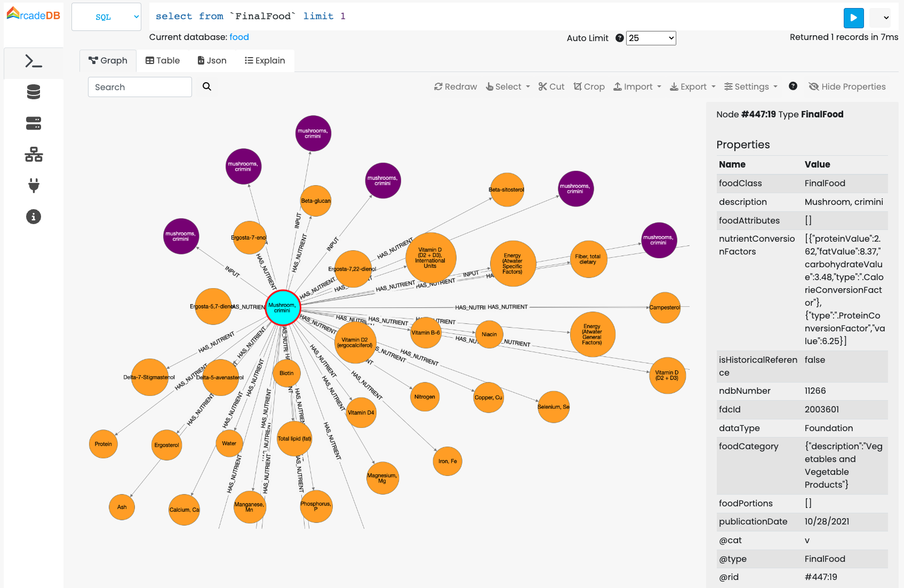

[[json-importer]]
==== JSON Importer

ArcadeDB is able to import data from JSON format.
Thanks to the flexible mapping, it's possible to define the rules of conversion between the input json file and the graph.

Without a `mapping`, a JSON source is imported as plain documents of the type set by `documentType` (default
`Document`): a single top-level object becomes one document, and a top-level array becomes one document per object
in it, each committed in its own transaction so that `onRowError = skip` can discard one without the others. An array
entry that is not an object is refused, naming its position. Numbers keep their exact value: with or without a
mapping, every JSON number is decoded exactly as the HTTP API decodes it. An integer is stored as an INTEGER when it
fits 32 bits, a LONG when it fits 64 bits and a DECIMAL beyond. Any other number is stored as a DOUBLE, unless a DOUBLE
would lose some of its digits (it has more than 17 significant digits) or cannot hold its magnitude (such as `1e309`),
and then as a DECIMAL. A number token that only a hostile payload writes (over 1000 characters, or an exponent beyond
1000) is refused as a row error. _(Since v26.11.1: a top-level array was
not recognised as JSON at all - a one-line array was imported as a CSV file holding nothing and the import reported
success - and every number was stored as a DOUBLE, so `42` became `42.0` and `9007199254740993` became
`9007199254740992`.)_

Let's start from this simple JSON file to import as an example. The file contains a flat structure of records with a relationship of employee and manager:

```json
{
  "Users":[
    {
      "EmployeeID":"1234",
      "ManagerID":"1230",
      "Name":"Marcus"
    },
    {
      "EmployeeID":"1230",
      "ManagerID":"1231",
      "Name":"Win"
    }
  ]
}
```

First, create a new database "employees" by using the console:

[source,sql]
----
> CREATE DATABASE employees
----

Then execute the following command (assuming the file above is saved in the local directory as `employees.json`:

[source,sql]
----
{employees}> IMPORT DATABASE employees.json WITH mapping = {
	"Users": [{
			"@cat": "v",
			"@type": "User",
			"@id": "id",
			"@idType": "string",
			"@strategy": "merge",
			"EmployeeID": "@ignore",
			"ManagerID": {
					"@cat": "e",
					"@type": "HAS_MANAGER",
					"@cardinality": "no-duplicates",
					"@in": {
							"@cat": "v",
							"@type": "User",
							"@id": "id",
							"@idType": "string",
							"@strategy": "merge",
							"EmployeeID": "@ignore",
							"id": "<../ManagerID>"
					}
			}
	}]
}
----

The mapping file is a JSON snippet with directives about what to import, what to ignore and how to map edges with JSON objects.
Below all the supported tags:

* `@cat`: is the category of record to use between "v" for vertex, "e" for edge and "d" for document
* `@type`: is the type name to use on record creation.
If the type doesn't exist, it's implicitly created during the import
* `@id`: is the property that works as primary key. if not already defined, a unique index is created on the configured `@id` property
* `@idType`: is the type of the primary key in the `@id` property.
If not defined, the type is taken from the first value found, widened for a number: an integral first id declares the
property LONG and any other number DECIMAL, whatever the size of that first value, so a later id past 2^31^ still fits
and two decimal ids that differ past the 17th digit stay two keys. You can, for example, use `@idType` DOUBLE to force
a DOUBLE key anyway _(Since v26.11.1: every number was read as a DOUBLE, so an integer key was declared DOUBLE, an
integer above 2^53^ lost its last digits, and two decimal ids that differ past the 17th digit collided in the unique
index, so the second record was silently skipped as already imported)_
* `@cardinality`: if "no-duplicates", the edges are not created if there is an edge of the same type between the two vertices
* `@strategy`: represents the strategy to use when the record with the configured `@id` already exists By default the existent record is used, but the "merge" strategy allows to merge the current record with the existent one.
The current properties will overwrite the existent ones
* `@in`: used for edges and represents the destination vertex for the edge
* `@ignore`: ignore the property, do not import into the database

Note the "id" property in the manager is taken by using `"<../ManagerID>"` that means get the property "ManagerID" from the parent (`../`).

How to import a JSON file with a hierarchical structure? Let's look at the second example coming from the JSON export of food and nutrients from the link:https://fdc.nal.usda.gov/download-datasets.html[U.S. DEPARTMENT OF AGRICULTURE website (USDA)].
USDA provides updated files to download in both CSV and JSON format.

First, create a new database "food" by using the console:

[source,sql]
----
> CREATE DATABASE food
----

Then execute the following command:

[source,sql]
----
{food}> IMPORT DATABASE https://fdc.nal.usda.gov/fdc-datasets/FoodData_Central_foundation_food_json_2022-10-28.zip WITH mapping = {
	"FoundationFoods": [{
		"@cat": "v",
		"@type": "<foodClass>",
		"foodNutrients": [{
			"@cat": "e",
			"@type": "HAS_NUTRIENT",
			"@in": "nutrient",
			"@cardinality": "no-duplicates",
			"nutrient": {
				"@cat": "v",
				"@type": "Nutrient",
				"@id": "id",
				"@idType": "long",
				"@strategy": "merge"
			},
			"foodNutrientDerivation": "@ignore"
		}],
		"inputFoods": [{
			"@cat": "e",
			"@type": "INPUT",
			"@in": "inputFood",
			"@cardinality": "no-duplicates",
			"inputFood": {
				"@cat": "v",
				"@type": "<foodClass>",
				"@id": "fdcId",
				"@idType": "long",
				"@strategy": "merge",
				"foodCategory": {
					"@cat": "e",
					"@type": "HAS_CATEGORY",
					"@cardinality": "no-duplicates",
					"@in": {
						"@cat": "v",
						"@type": "FoodCategory",
						"@id": "id",
						"@idType": "long",
						"@strategy": "merge"
					}
				}
			}
		}]
	}]
}
----



This command downloads the zip file from the USDA website and uses the mapping to create the graph from the JSON file.

The mapping file is a JSON snippet with directives about what to import, what to ignore and how to map edges with JSON objects.
Below all the supported tags:

* `@cat`: is the category of record to use between "v" for vertex, "e" for edge and "d" for document
* `@type`: is the type name to use on record creation.
If the type doesn't exist, it's implicitly created during the import
* `@id`: is the property that works as primary key. if not already defined, a unique index is created on the configured `@id` property
* `@idType`: is the type of the primary key in the `@id` property.
If not defined, the type is taken from the first value found, widened for a number: an integral first id declares the
property LONG and any other number DECIMAL, whatever the size of that first value, so a later id past 2^31^ still fits
and two decimal ids that differ past the 17th digit stay two keys. You can, for example, use `@idType` DOUBLE to force
a DOUBLE key anyway _(Since v26.11.1: every number was read as a DOUBLE, so an integer key was declared DOUBLE, an
integer above 2^53^ lost its last digits, and two decimal ids that differ past the 17th digit collided in the unique
index, so the second record was silently skipped as already imported)_
* `@cardinality`: if "no-duplicates", the edges are not created if there is an edge of the same type between the two vertices
* `@strategy`: represents the strategy to use when the record with the configured `@id` already exists By default the existent record is used, but the "merge" strategy allows to merge the current record with the existent one.
The current properties will overwrite the existent ones
* `@in`: used for edges and represents the destination vertex for the edge
* `@ignore`: ignore the property, do not import into the database
