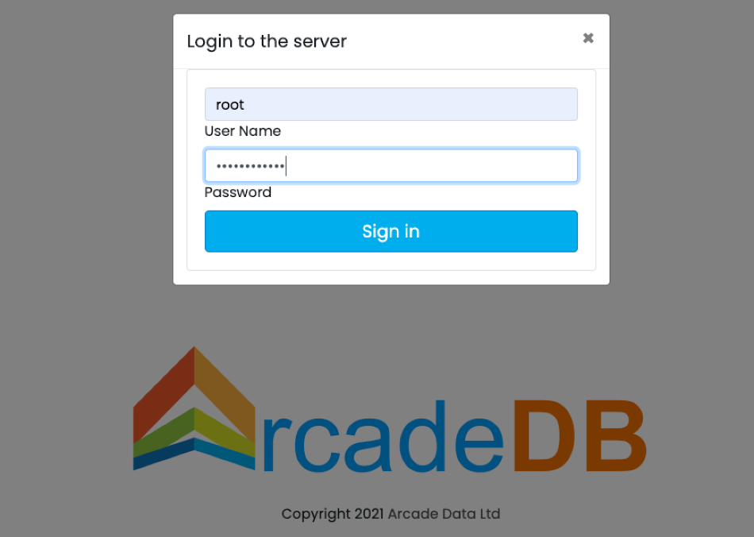
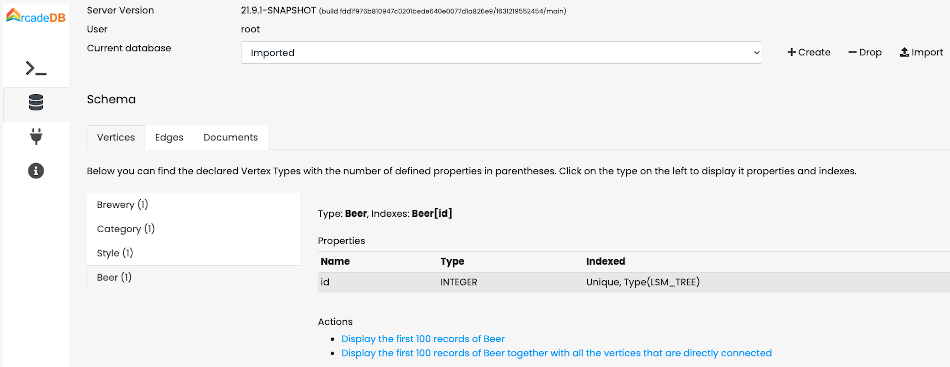
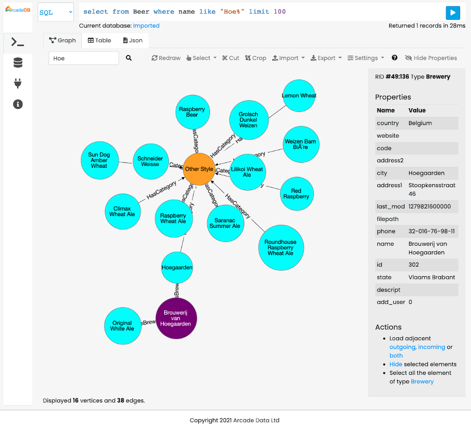

[[docker]]
==== Docker

To run the ArcadeDB server with Docker, type this (replace <password> with the root password you want to use):

[source,shell,subs="attributes+"]
----
$ docker run --rm -p 2480:2480 --name my_arcadedb \
             --env ARCADEDB_SETTINGS="-Darcadedb.server.rootPassword=playwithdata" \
             --hostname my_arcadedb arcadedata/arcadedb:{revnumber}
----

If there are no errors, Docker prints immediately the container id.
You can use that id to stop the container, or execute some commands from it.

NOTE: Pass ArcadeDB settings in `ARCADEDB_SETTINGS` and extra JVM flags in `JAVA_OPTS`. Docker
*replaces* an environment variable rather than adding to it, so putting `-Darcadedb.*` settings in
`JAVA_OPTS` would discard the garbage collector the image selects for you. Keeping the two apart means
your container runs the same JVM as one started with no environment at all (_since v26.9.1_).

[[docker-api-token]]
NOTE: With `arcadedb.server.apiTokenRequireSecureTransport=true` the server refuses to mint an API token over a plain-HTTP connection that does not come from the loopback address. The setting is `false` in 26.10.1 (an unprotected mint is only logged at WARNING) and is scheduled to default to `true` from 27.1.1. Once it is on, a container reached through a published port (`-p 2480:2480`) usually sees the Docker network gateway as the peer, not loopback, so *Create Token* in Studio on `http://localhost:2480` is answered with a `412`, and opening Studio "from the server host itself" does not help. For a local development container, either enable HTTPS or leave the check off with `-Darcadedb.server.apiTokenRequireSecureTransport=false` in `ARCADEDB_SETTINGS`. Do not turn it off for a server reachable from other machines. Behind a TLS-terminating reverse proxy, list the proxy in `arcadedb.server.apiTokenTrustedProxies` instead; see <<http-api-tokens,Create an API token>>.

To run the console from the container started above, use:

[source,shell,subs="attributes+"]
----
$ docker exec -it my_arcadedb bin/console.sh
ArcadeDB Console v{revnumber} - Copyrights (c) 2021 Arcade Data (https://arcadedb.com)

>
----

NOTE: The ArcadeDB image can also be used with https://podman.io[Podman], just replace `docker` with `podman` in the examples.

[[quick-start-docker]]
===== Quick start with the OpenBeer database

You can run ArcadeDB server with a demo database in less than 1 minute.
Run ArcadeDB server with docker specifying the database to import as a parameter in the docker command.

Example of running ArcadeDB Server with all the plugins enabled (Redis, Postgres, Mongo, Gremlin) that download and install OrientDB's `OpenBeer` dataset:

[source,shell]
----
$ docker run --rm  -p 2480:2480 -p 6379:6379 -p 5432:5432 -p 8182:8182 --env ARCADEDB_SETTINGS="\
   -Darcadedb.server.rootPassword=playwithdata \
   -Darcadedb.server.defaultDatabases=Imported[root]{import:https://github.com/ArcadeData/arcadedb-datasets/raw/main/orientdb/OpenBeer.gz} \
   -Darcadedb.server.plugins=Redis:com.arcadedb.redis.RedisProtocolPlugin, \
                             MongoDB:com.arcadedb.mongo.MongoDBProtocolPlugin, \
                             Postgres:com.arcadedb.postgres.PostgresProtocolPlugin, \
                             GremlinServer:com.arcadedb.server.gremlin.GremlinServerPlugin" \
         arcadedata/arcadedb:latest
----

Now point your browser on **http://localhost:2480** and you'll see ArcadeDB Studio.
Now enter "root" as a user and "playwithdata" as a password.

NOTE: User and password are specified in the docker command above.

Now click on the "Database" icon on the toolbar on the left.
This is the database schema.
Click on "OpenBeer" vertex type and then on the action "Display the first 100 records of Beer together with all the vertices that are directly connected".

You should see the first 100 beers in the database and all their connections.

===== Persistence

By default, data created in a Docker container is lost when the container stops. To preserve your ArcadeDB databases beyond the container's lifecycle, you need to configure persistent storage by mounting volumes.

====== Understanding ArcadeDB's Database Directory

ArcadeDB stores its databases in the `/home/arcadedb/databases` directory by default. This is the path you need to mount to persist your data. You can customize this location using the `-Darcadedb.server.databaseDirectory` setting if needed.

====== Docker Volumes vs. Bind Mounts

Docker offers two approaches for persistent storage:

1. **https://docs.docker.com/storage/volumes/[Docker volumes]** - Docker-managed storage sections on the host filesystem. Docker handles the storage location, permissions, and lifecycle. This is the recommended approach for most use cases as it's more portable and easier to manage.

2. **https://docs.docker.com/storage/bind-mounts/[Bind mounts]** - Direct mapping to a specific path on your host machine. This gives you full control over the exact location of your data files and allows direct access to them from the host. Useful when you need to inspect, backup, or manipulate the database files directly.

See the https://docs.docker.com/storage/[Docker storage documentation] for detailed setup instructions.

====== Persisting the Database Directory

The default path `/home/arcadedb/databases` contains all your database files. Mount this directory to make your data persistent. Here's an example using a bind mount:

[source,shell,subs="attributes+"]
----
$ docker run --rm -p 2480:2480 --name my_arcadedb \
    -v /path/on/host/databases:/home/arcadedb/databases \
    --env ARCADEDB_SETTINGS="-Darcadedb.server.rootPassword=playwithdata" \
    --hostname my_arcadedb arcadedata/arcadedb:{revnumber}
----

Replace `/path/on/host/databases` with your desired directory path. All database read and write operations will occur on this mounted volume.

TIP: If you prefer using Docker volumes instead of bind mounts, replace `-v /path/on/host/databases:/home/arcadedb/databases` with `-v arcadedb-data:/home/arcadedb/databases` where `arcadedb-data` is your chosen volume name.

====== Alternative: Custom Database Directory

If you need to change where ArcadeDB stores databases, use the `-Darcadedb.server.databaseDirectory` setting and mount your volume to match the new path:

[source,shell,subs="attributes+"]
----
$ docker run --rm -p 2480:2480 --name my_arcadedb \
    -v /path/on/host/databases:/mydatabases \
    --env ARCADEDB_SETTINGS="-Darcadedb.server.databaseDirectory=/mydatabases \
                     -Darcadedb.server.rootPassword=playwithdata" \
    --hostname my_arcadedb arcadedata/arcadedb:{revnumber}
----

This example changes the database directory to `/mydatabases` and mounts the volume to that location.

====== Alternative: Backup-Only Persistence

For better performance, you can keep databases in container storage and only persist backups. All database operations occur in fast container storage, but you must perform regular backups:

[source,shell,subs="attributes+"]
----
$ docker run --rm -p 2480:2480 --name my_arcadedb \
    -v /path/on/host/backups:/home/arcadedb/backups \
    --env ARCADEDB_SETTINGS="-Darcadedb.server.rootPassword=playwithdata" \
    --hostname my_arcadedb arcadedata/arcadedb:{revnumber}
----

The default backup directory is `/home/arcadedb/backups`. You can customize it with `-Darcadedb.server.backupDirectory=/mybackup`. Remember to execute regular <<sql-backup-database,`BACKUP DATABASE`>> operations.

NOTE: The optimal strategy depends on your infrastructure. "Local storage" performance characteristics vary between bare metal, virtual machines, and container orchestration platforms.

====== Comprehensive Persistence Example

Mount multiple directories for complete data, backup, log, and configuration persistence:

[source,shell,subs="attributes+"]
----
$ docker run --rm -p 2480:2480 --name my_arcadedb \
    -v /path/on/host/databases:/home/arcadedb/databases \
    -v /path/on/host/backups:/home/arcadedb/backups \
    -v /path/on/host/log:/home/arcadedb/log \
    -v /path/on/host/config:/home/arcadedb/config \
    --env ARCADEDB_SETTINGS="-Darcadedb.server.rootPassword=playwithdata" \
    --hostname my_arcadedb arcadedata/arcadedb:{revnumber}
----

[[docker-image-user]]
====== Image user and volumes

_(Since v26.11.1)_ The JVM image and both native images (`linux/amd64` and `linux/arm64`) run as `1000:1000`, and their `bin`, `config`, `databases`, `backups`, `replication` and `log` folders are owned by that user, so no `--user` is needed and a volume written by one image can be opened by another. Before, the amd64 native image ran as root and the arm64 native image as UID 65532 (`nonroot`).
A bind mount keeps the ownership of the host directory and must be writable by UID 1000.

An existing volume or bind mount written by an earlier native image is owned by root (amd64) or 65532 (arm64), and the new image cannot write to it. Re-own it once before upgrading:

[source,shell]
----
$ chown -R 1000:1000 <volume or bind-mount path>
----

The image declares five volumes: `config`, `databases`, `replication`, `backups` and `log`. Mount all five to keep the users, groups and API tokens the server writes to `config`, and the HA state in `replication`, across container recreation. The `docker-compose.yml` quickstart mounts a named volume on each of them (the `databases` volume keeps its name, `arcade_db_vol`, so existing databases stay where they are); before v26.11.1 it mounted a named volume on `databases` only, so users, groups and API tokens created at runtime were lost on `docker compose down -v`. To keep them, copy them out of the old container before recreating the stack, then into the new one, and restart the service:

[source,shell]
----
$ docker cp <old container>:/home/arcadedb/config/. ./config-backup
$ docker cp ./config-backup/. <new container>:/home/arcadedb/config
----

A custom distribution image generated by `arcadedb-builder.sh` follows the same rules since v26.11.1: it runs as `1000:1000` and declares the same five volumes (before, it ran as `100:101` and declared only `databases`, `backups` and `log`). A volume written by an earlier custom image must be re-owned once with `chown -R 1000:1000` on `config`, `databases`, `replication`, `backups` and `log`.
In a custom image, a named volume mounted on `config` is seeded with the image's default configuration files on first use; a bind mount on `config` starts out empty and hides them. Once `config` holds state it is not refreshed from the image, so a default file added by a later release does not appear in an existing volume.

[[docker-config-directory]]
====== Relocating the configuration directory

The server keeps its configuration files in `/home/arcadedb/config`: `server-configuration.json`, the users, groups and API
tokens (`server-users.jsonl`, `server-groups.json`, `server-api-tokens.json`), `backup.json`, `ai.json`, `mcp-config.json` and
`gremlin-server.yaml`. Since v26.10.1 you can move them with `arcadedb.server.configDirectory`, for example onto the volume that
already holds the databases, so a single mount persists both:

[source,shell,subs="attributes+"]
----
$ docker run --rm -p 2480:2480 --name my_arcadedb \
    -v /path/on/host/arcadedb:/data \
    --env ARCADEDB_SETTINGS="-Darcadedb.server.databaseDirectory=/data/databases \
                     -Darcadedb.server.configDirectory=/data/config \
                     -Darcadedb.server.rootPassword=playwithdata" \
    --hostname my_arcadedb arcadedata/arcadedb:{revnumber}
----

Keep in mind:

* Pass the setting as a `-D` property (here through `ARCADEDB_SETTINGS`). Setting it in `server-configuration.json` has no
  effect, because that file is itself read from the configuration directory.
* The server creates the directory if it does not exist. _(Since v26.11.1)_ A directory that holds no file yet is filled with the
  shipped defaults the first time the server starts on it: `server-groups.json`, `gremlin-server.yaml`, `gremlin-server.groovy` and
  `gremlin-server.properties`. They come from the server jar, so this works on the native images and on a Kubernetes volume claim, which is
  never populated from the image. A directory that already holds a file is not touched: edits are never overwritten, a file deleted on purpose
  does not come back, and defaults that a later release adds do not reach a directory already in use, so merge them by hand after an
  upgrade. Before v26.11.1 the server copied nothing and you had to copy them over yourself.
* Logging is not affected: `arcadedb-log.properties` is still loaded through `-Djava.util.logging.config.file`.

===== Tuning

The image sizes the JVM heap as a share of the container's memory limit (`-XX:MaxRAMPercentage=75`),
so in most cases there is nothing to tune: give the container the memory you want ArcadeDB to have and
the heap follows.
The image also selects generational ZGC through `ARCADEDB_OPTS_GC`. See
<<jvm-settings-fixed-memory,JVM settings inside a fixed memory budget>> for how the heap share and the collector are chosen, and
why a heap pinned with `-Xms` equal to `-Xmx` inflates the memory the container reports.

[source,shell]
----
$ docker run -m 4g ... arcadedata/arcadedb:latest
----

NOTE: _Since v26.9.1_ the heap is sized from the container limit. Earlier images pinned it to 2 GB
(`-Xms2G -Xmx2G`), which meant a container limited to less than about 2.3 GB was killed at startup
before the server came up.

To set the heap explicitly instead, override `ARCADEDB_OPTS_MEMORY`:

[source,shell]
----
$ docker ... -e ARCADEDB_OPTS_MEMORY="-Xms800M -Xmx800M" ...
----

To run ArcadeDB with RAM <800M, it's suggested to tune some settings.
You can use the `low-ram` profile to use the least memory possible.

[source,shell]
----
$ docker ... -e ARCADEDB_OPTS_MEMORY="-Xms800M -Xmx800M" -e ARCADEDB_SETTINGS="-Darcadedb.profile=low-ram" ...
----
