[[shortest-path-guide]]
==== Shortest Path

ArcadeDB answers "what is the shortest way from A to B?" in several ways, from SQL, Cypher and Java. This page helps you pick one, walks through all of them on a small road network of Italy you can load in a few seconds, and explains when a *Customizable Contraction Hierarchy* (CCH) turns a weighted shortest path from milliseconds into microseconds.

NOTE: Customizable Contraction Hierarchies (`CCH (...)` on a Graph Analytical View, `cchShortestPath()`, `algo.cch.shortestPath`) are available starting with ArcadeDB 26.10.2.

[[shortest-path-choosing]]
===== Choosing an Algorithm

[cols="3,3,3", options="header"]
|===
| You need | SQL | Cypher

| The fewest hops, edges unweighted
| <<algo-shortest-path-sql,shortestPath()>>
| the `shortestPath()` pattern, <<algo-bfs,algo.bfs>>

| The lightest path, weights not negative, occasional queries
| <<algo-dijkstra-sql,dijkstra()>>
| <<algo-dijkstra,algo.dijkstra>>

| The same, guided by coordinates (latitude/longitude, x/y)
| <<astar,astar()>>
| <<algo-astar,algo.astar>>

| Many point-to-point queries on a road, logistics or utility network
| <<algo-cch-shortest-path-sql,cchShortestPath()>>
| <<algo-cch-shortest-path,algo.cch.shortestPath>>

| Negative weights
| <<algo-bellman-ford-sql,bellmanFord()>>
| <<algo-bellman-ford,algo.bellmanford>>

| Alternatives: the k best routes
| -
| <<algo-k-shortest-paths,algo.kShortestPaths>>

| Distances from one source to every vertex
| -
| <<algo-dijkstra-single-source,algo.dijkstra.singleSource>>
|===

All weighted path finders read the weight the same way: the numeric value of the weight property, `1` when an edge has none, and an edge whose value is negative, NaN or infinite is not walked (only `bellmanFord()` walks negative weights). Among parallel edges the cheapest counts. Given the same graph they return the same shortest distance.

[[shortest-path-dijkstra-astar-cch]]
===== Dijkstra, A* and CCH

*Dijkstra* settles vertices in order of distance from the source, so its search is a growing circle: the farther the destination, the more of the graph it reads. *A** adds an estimate of the remaining distance (for example the straight line between two coordinates) and leans the circle toward the destination. Both need nothing prepared in advance, and both slow down as routes get longer.

A *Customizable Contraction Hierarchy* moves the work ahead of the queries. Once, it ranks the vertices so that the small sets of vertices that split the network (on a road map: the few junctions where long routes must pass) sit at the top, and adds shortcut edges so that every route can go up the ranking and then down. A query then only climbs from both endpoints to the top and unpacks the shortcuts on the way: its cost depends on the height of the hierarchy, not on the distance between the two vertices. On the Florida road network that is about 0.01 to 0.04 ms for any route, against 8 to 104 ms for Dijkstra and 3 to 132 ms for A* (see <<shortest-path-performance>>).

The *customizable* part matters for real networks: the ranking and the shortcuts depend only on which roads exist, not on what they cost. When a weight changes (traffic, a closure) only the costs of the shortcuts above that road are recomputed, typically in a millisecond. See <<gav-cch>> for the details of each phase.

[[shortest-path-italy]]
===== Try It: the Italy Road Network

The sample is a small, approximate road network: 121 Italian cities with their coordinates and 212 two-way roads, each with a length in kilometers (`km`) and a travel time in minutes (`minutes`, at 90 km/h). Four ferries are included: short in kilometers, slow in minutes. It is meant to show the algorithms, not to plan a trip.

[source,sql]
----
CREATE VERTEX TYPE City;
CREATE PROPERTY City.name STRING;
CREATE PROPERTY City.lat DOUBLE;
CREATE PROPERTY City.lon DOUBLE;
CREATE INDEX ON City (name) UNIQUE;

CREATE EDGE TYPE ROAD;
CREATE PROPERTY ROAD.km INTEGER;
CREATE PROPERTY ROAD.minutes INTEGER;
CREATE PROPERTY ROAD.ferry BOOLEAN;

INSERT INTO City SET name = "Roma", lat = 41.903, lon = 12.496;
...
CREATE EDGE ROAD FROM (SELECT FROM City WHERE name = "Roma") TO (SELECT FROM City WHERE name = "Rieti")
  SET km = 76, minutes = 51, ferry = false;
...
----

The data set lives in the https://github.com/ArcadeData/arcadedb-usecases/tree/main/route-planning[route-planning use case]: `sql/01-schema.sql` (the types above), `sql/02-data.sql` (the cities and the roads) and `sql/03-view.sql` (the view of <<shortest-path-italy-cch>>). Clone the repository, enter `route-planning`, then pick one:

* *Docker*: `docker compose up -d` and `./setup.sh` start ArcadeDB, create the `RoutePlanning` database, load the files and create the view. `./queries/queries.sh` then runs the queries of this page with curl, and the `java` folder runs them from a Java client.
* *Your own server*: `ARCADEDB_URL=http://localhost:2480 ARCADEDB_PASS=<root password> ./setup.sh`.
* *Console*: `create database RoutePlanning`, then `load sql/01-schema.sql` and `load sql/02-data.sql`.

The roads are stored in one direction, as they were listed, and every query below walks them in both (`BOTH`). To model one-way streets, store each direction as its own edge and query with `OUT`.

[[shortest-path-italy-sql]]
====== Dijkstra, A* and the Fewest Hops in SQL

The path functions return the vertices of the path in order. `expand()` turns them into rows:

[source,sql]
----
SELECT name FROM (
  SELECT expand(dijkstra($from, $to, 'minutes', { direction: 'BOTH', edgeTypeNames: ['ROAD'] }))
  LET $from = (SELECT FROM City WHERE name = 'Roma'),
      $to   = (SELECT FROM City WHERE name = 'Palermo')
)
----

Roma, Latina, Gaeta, Caserta, Avellino, Salerno, Sapri, Castrovillari, Cosenza, Lamezia Terme, Vibo Valentia, Villa San Giovanni, Messina, Cefalù, Palermo: 681 minutes, with the ferry across the Strait of Messina.

A* needs the vertex properties that hold the coordinates and an estimate that never exceeds the real remaining cost. With `lat`/`lon` in degrees, a degree is at least 75 km anywhere in Italy, which is 50 minutes at 90 km/h: `dFactor: 50` for a weight in minutes (`dFactor: 75` for one in kilometers) keeps the estimate below the real cost:

[source,sql]
----
SELECT astar($from, $to, 'minutes', { direction: 'BOTH', edgeTypeNames: ['ROAD'],
                                      vertexAxisNames: ['lat', 'lon'], heuristicFormula: 'EUCLIDEAN',
                                      dFactor: 50, tieBreaker: false }) AS path
LET $from = (SELECT FROM City WHERE name = 'Roma'),
    $to   = (SELECT FROM City WHERE name = 'Palermo')
----

An estimate that overshoots makes A* faster but no longer guarantees the shortest path.

`shortestPath()` ignores weights and minimizes the number of roads: 5 here, through Napoli and the overnight ferry:

[source,sql]
----
SELECT shortestPath($from, $to, 'BOTH') AS path
LET $from = (SELECT FROM City WHERE name = 'Roma'),
    $to   = (SELECT FROM City WHERE name = 'Palermo')
----

In Cypher, the fewest hops is a pattern:

[source,cypher]
----
MATCH p = shortestPath((a:City {name: 'Roma'})-[:ROAD*]-(b:City {name: 'Palermo'}))
RETURN length(p) AS hops
----

[[shortest-path-italy-cch]]
====== Adding a Contraction Hierarchy

A contraction hierarchy lives on a <<graph-olap,Graph Analytical View>>, one per weight property. One view can keep several, here one for distance and one for travel time:

[source,sql]
----
CREATE GRAPH ANALYTICAL VIEW Italy
  EDGE TYPES (ROAD)
  UPDATE MODE SYNCHRONOUS
  CCH (km, minutes)
----

`./setup.sh` has already created it (`sql/03-view.sql`); from the console, run the statement above or `load sql/03-view.sql`.

The view and its hierarchies are built in the background, in milliseconds for this graph and seconds for a country-sized one. Queries never wait for them: until a hierarchy is ready they are answered by bidirectional Dijkstra, with the same result.

[source,sql]
----
SELECT name FROM (
  SELECT expand(cchShortestPath($from, $to, 'minutes', { direction: 'BOTH', edgeTypeNames: ['ROAD'] }))
  LET $from = (SELECT FROM City WHERE name = 'Roma'),
      $to   = (SELECT FROM City WHERE name = 'Palermo')
)
----

[source,cypher]
----
MATCH (a:City {name: 'Roma'}), (b:City {name: 'Palermo'})
CALL algo.cch.shortestPath(a, b, 'ROAD', 'minutes', 'BOTH') YIELD path, weight
RETURN [c IN path.nodes | c.name] AS route, weight
----

Same route, same 681 minutes. `path` is a map with `nodes`, `relationships` (the cheapest edge between each pair of consecutive nodes) and `length`.

TIP: Name the edge types the view covers (`edgeTypeNames` in SQL, the relationship types in Cypher). A query without them walks *every* edge type of the database, and as soon as the schema has an edge type the view does not cover, that is a different graph from the one the hierarchy was built for: the query is answered by Dijkstra.

[[shortest-path-italy-metrics]]
====== Two Metrics, Two Routes

The shortest route is not always the fastest one. From Roma to Palermo:

[source,cypher]
----
MATCH (a:City {name: 'Roma'}), (b:City {name: 'Palermo'})
CALL algo.cch.shortestPath(a, b, 'ROAD', $metric, 'BOTH') YIELD path, weight
RETURN [c IN path.nodes | c.name] AS route, weight
----

[cols="1,1,4", options="header"]
|===
| `$metric` | weight | route

| `km` | 600 | Roma, Latina, Gaeta, Caserta, Napoli, Palermo (the overnight ferry)
| `minutes` | 681 | Roma, Latina, Gaeta, Caserta, Avellino, Salerno, Sapri, Castrovillari, Cosenza, Lamezia Terme, Vibo Valentia, Villa San Giovanni, Messina, Cefalù, Palermo
|===

Both hierarchies share the same view and are kept up to date together.

[[shortest-path-italy-traffic]]
====== Live Traffic

A weight is an ordinary edge property: change it with a normal `UPDATE` and the hierarchy follows. The fastest route from Bologna to Roma, 287 minutes, runs over the A1 through Prato and Firenze. Four hours of queue between Bologna and Prato:

[source,sql]
----
UPDATE ROAD SET minutes = 240 WHERE @out.name = 'Bologna' AND @in.name = 'Prato'
----

Right after the commit the hierarchy re-prices the arcs above that road (about a millisecond on this graph; 0.19 ms after the commit for a single road on the 1.07-million-junction Florida network), and the fastest route becomes Bologna, Forlì, Arezzo, Perugia, Foligno, Terni, Rieti, Roma: 295 minutes. A query that arrives in between is answered by bidirectional Dijkstra, so no answer is ever older than the data.

A closed road is a road that cannot be walked. Since a negative weight is never walked, closing it is an update too, and the hierarchy treats it the same way. The Strait of Messina ferry stops:

[source,sql]
----
UPDATE ROAD SET minutes = -1 WHERE @out.name = 'Villa San Giovanni' AND @in.name = 'Messina'
----

Roma to Palermo by travel time now takes the overnight ferry from Napoli: 830 minutes. Setting `minutes` back to 40 reopens it.

[[shortest-path-italy-java]]
====== From Java

The same steps from an embedded database: no server, no build step. From the `route-planning` directory of the use case, with Java 21 or later and the `lib` directory of an ArcadeDB distribution:

[source,shell]
----
java -cp "$ARCADEDB_HOME/lib/*" embedded/ItalyRoutes.java
----

The core of it:

[source,java]
----
try (Database db = new DatabaseFactory("./target/databases/italy-routes").create()) {
  db.command("sqlscript", Files.readString(Path.of("sql/01-schema.sql")));
  String data = Files.readString(Path.of("sql/02-data.sql"));
  db.transaction(() -> db.command("sqlscript", data));

  db.command("sql", "CREATE GRAPH ANALYTICAL VIEW Italy EDGE TYPES (ROAD) UPDATE MODE SYNCHRONOUS CCH (km, minutes)");

  // optional: wait for the view and its hierarchies, so the first queries already use them
  GraphAnalyticalView view = GraphAnalyticalViewRegistry.get(db, "Italy");
  view.awaitReady(60, TimeUnit.SECONDS);
  for (ContractionHierarchy cch : view.getContractionHierarchies())
    cch.awaitReady(true, 60, TimeUnit.SECONDS); // true: also prepare undirected ('BOTH') queries

  try (ResultSet rs = db.query("opencypher", """
      MATCH (a:City {name: $from}), (b:City {name: $to})
      CALL algo.cch.shortestPath(a, b, 'ROAD', 'minutes', 'BOTH') YIELD path, weight
      RETURN [c IN path.nodes | c.name] AS route, weight""", Map.of("from", "Bologna", "to", "Roma"))) {
    Result row = rs.next();
    System.out.println(row.getProperty("route") + " " + row.getProperty("weight") + " min");
  }
}
----

The view can also be defined with the builder, `GraphAnalyticalView.builder(db).withName("Italy").withEdgeTypes("ROAD").withUpdateMode(UpdateMode.SYNCHRONOUS).withContractionHierarchy("km").withContractionHierarchy("minutes").build()`.

The full example also compares `dijkstra()`, `astar()` and `cchShortestPath()` on the same route, shows the two metrics, and applies the traffic update. On a laptop, Roma to Palermo takes about 200 µs with `dijkstra()`, 130 µs with `astar()` and 40 µs with `cchShortestPath()`, SQL parsing included: on 121 cities there is little for a hierarchy to save. The gap grows with the network.

[[shortest-path-engine]]
===== Which Engine Answered?

`algo.cch.shortestPath` and `cchShortestPath()` always return the exact shortest path, and pick the fastest way to compute it: the hierarchy when one is ready for exactly the weight, the edge types and the current state of the data; otherwise bidirectional Dijkstra on the view's columns, or on the records. Two ways to see which one was used:

* Each hierarchy counts the queries it answered and the ones it handed back to Dijkstra:
+
[source,sql]
----
SELECT name, status, contractionHierarchies FROM schema:graphAnalyticalViews
----
+
Each entry reports `weightProperty`, `status` (`PREPARING`, `READY`, `UNSUITABLE`, `UNAVAILABLE`), `arcs`, `memoryUsageBytes`, `queries`, `fallbacks`, the number of full and partial customizations and `lastIncrementalUpdateMicros`, the time the last update took from commit to ready.
* `PROFILE` on a Cypher query prints `CSR-accelerated via Graph Analytical View` when the hierarchy answered.

A query is answered by Dijkstra, exactly and only more slowly, when:

* the hierarchy is still being built or catching up with a commit;
* it is the first undirected (`BOTH`) query on the hierarchy: directed queries are prepared from the start, the undirected metric is prepared on the first request (or by `awaitReady(true, ...)` in Java);
* the calling transaction holds uncommitted changes, which no view can see;
* the weight property or the set of edge types differs from the hierarchy's (see the tip above);
* the graph has no small separators, as social graphs or graphs with supernodes: the hierarchy would be many times larger than the graph, so it is not built and reports `UNSUITABLE` (bound by `arcadedb.gavCchMaxArcsPerEdge`, default 16 arcs per edge).

[[shortest-path-performance]]
===== Performance

image::../../images/cch-florida-query-time.svg[Query time against distance on the Florida road network, from Tallahassee: CCH flat at 0.010 to 0.041 ms, Dijkstra rising from 7.8 to 104 ms, A* from 3.1 to 132 ms; Tallahassee to Coral Gables 0.039 ms against 99 and 121 ms]

Measured with `CCHRoadNetworkBenchmark` (engine test sources) on the DIMACS Florida road network (`USA-road-d.FLA`, 1,070,376 junctions, 2,712,798 road segments), Apple M5 Pro, median of three runs. The routes start in Tallahassee and go to 12 destinations at the quantiles of its shortest-path tree, plus Coral Gables:

[cols="3,2,2,2", options="header"]
|===
| | CCH | Dijkstra | A*

| Query, 12 destinations from near to farthest | 0.010 - 0.041 ms | 7.8 - 104 ms | 3.1 - 132 ms
| Tallahassee to Coral Gables | 0.039 ms | 99 ms | 121 ms
| Memory per query | 6 - 43 KB | 11 - 44 MB | 9 - 52 MB
| Query through the database (record ids in and out) | 0.04 - 0.06 ms | |
| Update 1 / 10 / 100 road weights, commit + catch-up | 0.8 / 8.3 / 41 ms | |
| Close a road | 0.95 ms | |
| Add a road between two junctions the hierarchy does not join | 0.46 s | |
| First build: view, then hierarchy ready | 1.7 s, 6.6 s | |
| View + hierarchy memory | 306 MB | |
|===

Dijkstra and A* are the benchmark's reference implementations on primitive arrays, the fairest baselines for the algorithms themselves. A* estimates the remaining cost with the straight line to the destination, scaled so that it never exceeds the cost of any road segment, which is what keeps it exact. In this data 112 of the 2.7 million segments are shorter than the straight line between their ends, so the estimate is capped at 67% of the true distance: A* is 2.5 times faster than Dijkstra for nearby destinations and slower across the state.

To reproduce it, download `USA-road-d.FLA.gr.gz` and `USA-road-d.FLA.co.gz` (the coordinates, for A*) from the http://www.diag.uniroma1.it/challenge9/download.shtml[9th DIMACS Implementation Challenge] and run, from the ArcadeDB source tree (472033 and 624638 are the DIMACS ids of the junctions nearest to Tallahassee and Coral Gables):

[source,shell]
----
mvn -pl engine test -Dtest=CCHRoadNetworkBenchmark -DexcludedGroups=none -Dsurefire.failIfNoSpecifiedTests=false \
    -Dcch.dimacs=/path/to/USA-road-d.FLA.gr.gz -Dcch.coordinates=/path/to/USA-road-d.FLA.co.gz \
    -Dcch.source=472033 -Dcch.target=624638
----

Without `-Dcch.dimacs` it runs on a synthetic 300 x 300 grid, the hardest case for this technique. Without `-Dcch.source` the routes start from the first junction of the file, and without `-Dcch.coordinates` A* is skipped.

*References*

- Dibbelt, Strasser, Wagner: _Customizable Contraction Hierarchies_, ACM Journal of Experimental Algorithmics 21 (2016)
- See <<gav-cch>> for how the hierarchy is built, kept up to date and persisted, and <<algo-cch-shortest-path>> / <<algo-cch-shortest-path-sql>> for the full reference of the procedure and the function.
