[[shortest-path-guide]]
==== Shortest Path

ArcadeDB answers "what is the shortest way from A to B?" in several ways, from SQL, Cypher and Java. This page helps you pick one, walks through all of them on the real road network of Florida (1.07 million junctions) from Tallahassee to Coral Gables, and explains when a *Customizable Contraction Hierarchy* (CCH) turns a weighted shortest path from milliseconds into microseconds.

NOTE: Customizable Contraction Hierarchies (`CCH (...)` on a Graph Analytical View, `cchShortestPath()`, `algo.cch.shortestPath`) are available starting with ArcadeDB 26.10.2.

[[shortest-path-choosing]]
===== Choosing an Algorithm

[cols="3,3,3", options="header"]
|===
| You need | SQL | Cypher

| The fewest hops, edges unweighted
| <<algo-shortest-path-sql,shortestPath()>>
| the `shortestPath()` pattern, <<algo-bfs,algo.bfs>>

| The lightest path, weights not negative, occasional queries
| <<algo-dijkstra-sql,dijkstra()>>
| <<algo-dijkstra,algo.dijkstra>>

| The same, guided by coordinates (latitude/longitude, x/y)
| <<astar,astar()>>
| <<algo-astar,algo.astar>>

| Many point-to-point queries on a road, logistics or utility network
| <<algo-cch-shortest-path-sql,cchShortestPath()>>
| <<algo-cch-shortest-path,algo.cch.shortestPath>>

| Negative weights
| <<algo-bellman-ford-sql,bellmanFord()>>
| <<algo-bellman-ford,algo.bellmanford>>

| Alternatives: the k best routes
| -
| <<algo-k-shortest-paths,algo.kShortestPaths>>

| Distances from one source to every vertex
| -
| <<algo-dijkstra-single-source,algo.dijkstra.singleSource>>
|===

All weighted path finders read the weight the same way: the numeric value of the weight property, `1` when an edge has none, and an edge whose value is negative, NaN or infinite is not walked (only `bellmanFord()` walks negative weights). Among parallel edges the cheapest counts. Given the same graph they return the same shortest distance.

[[shortest-path-dijkstra-astar-cch]]
===== Dijkstra, A* and CCH

*Dijkstra* settles vertices in order of distance from the source, so its search is a growing circle: the farther the destination, the more of the graph it reads. From Tallahassee to Coral Gables it settles 1,029,617 of Florida's 1,070,376 junctions. *A** adds an estimate of the remaining distance (for example the straight line between two coordinates) and leans the circle toward the destination: 840,138 junctions. Both need nothing prepared in advance, and both slow down as routes get longer.

A *Customizable Contraction Hierarchy* moves the work ahead of the queries. Once, it ranks the vertices so that the small sets of vertices that split the network (on a road map: the few junctions where long routes must pass; in Florida, 17 junctions cut the state in two) sit at the top, and adds shortcut edges so that every route can go up the ranking and then down. A query then only climbs from both endpoints to the top and unpacks the shortcuts on the way: 346 junctions for the same route. Its cost depends on the height of the hierarchy, not on the distance between the two vertices: on the Florida road network that is about 0.01 to 0.04 ms for any route, against 8 to 104 ms for Dijkstra and 3 to 132 ms for A* (see <<shortest-path-performance>>).

The *customizable* part matters for real networks: the ranking and the shortcuts depend only on which roads exist, not on what they cost. When a weight changes (traffic, a closure) only the costs of the shortcuts above that road are recomputed, typically in a millisecond. See <<gav-cch>> for the details of each phase.

[[shortest-path-florida]]
===== Try It: the Florida Road Network

The examples use the Florida road network of the http://www.diag.uniroma1.it/challenge9/download.shtml[9th DIMACS Implementation Challenge], derived from the US Census TIGER/Line data: 1,070,376 junctions with their coordinates and 2,712,798 directed road segments, each with a length in kilometers (`km`) and a travel time in minutes (`minutes`). A two-way road is two segments, one per direction.

[source,sql]
----
CREATE VERTEX TYPE Junction;
CREATE PROPERTY Junction.id INTEGER;
CREATE PROPERTY Junction.lat DOUBLE;
CREATE PROPERTY Junction.lon DOUBLE;
CREATE PROPERTY Junction.name STRING;

CREATE EDGE TYPE ROAD;
CREATE PROPERTY ROAD.km DOUBLE;
CREATE PROPERTY ROAD.minutes DOUBLE;
----

The https://github.com/ArcadeData/arcadedb-usecases/tree/main/route-planning[route-planning use case] downloads the three DIMACS files (`USA-road-d.FLA.gr.gz` for the lengths, `USA-road-t.FLA.gr.gz` for the travel times, `USA-road-d.FLA.co.gz` for the coordinates), converts them and loads them with <<java-batch-importer,GraphBatch>>. `km` is the DIMACS length, in tenths of a meter, divided by 10,000. `minutes` reads the DIMACS travel time as millionths of an hour: the files do not state the unit, but with that reading the four road classes drive at 40, 60, 80 and 100 km/h. Clone the repository, enter `route-planning`, then pick one:

* *Docker*: `docker compose up -d` and `./setup.sh` start ArcadeDB, create the `RoutePlanning` database, load the network with one request to the <<http-batch,batch endpoint>> (about 11 seconds), name a few junctions after their cities (`sql/02-places.sql`: Tallahassee, Coral Gables, Orlando, Tampa, Jacksonville, Miami, Gainesville, Pensacola) and create the view of <<shortest-path-florida-cch>>. `./queries/queries.sh` then runs the queries of this page with curl, and the `java` folder runs them from a Java client.
* *Your own server*: `ARCADEDB_URL=http://localhost:2480 ARCADEDB_PASS=<root password> ./setup.sh`. The load is a 150 MB request: raise `arcadedb.server.httpBodyContentMaxSize` above its 100 MB default, as the use case's `docker-compose.yml` does.
* *Embedded*: see <<shortest-path-florida-java>>.

The segments are directed, so every query below walks them with `OUT`. On a graph that stores each road once and walks it both ways, use `BOTH`.

[[shortest-path-florida-sql]]
====== Dijkstra, A* and the Fewest Hops in SQL

The path functions return the vertices of the path in order. `expand()` turns them into rows:

[source,sql]
----
SELECT lat, lon FROM (
  SELECT expand(dijkstra($from, $to, 'minutes', { direction: 'OUT', edgeTypeNames: ['ROAD'] }))
  LET $from = (SELECT FROM Junction WHERE name = 'Tallahassee'),
      $to   = (SELECT FROM Junction WHERE name = 'Coral Gables')
)
----

1,501 junctions and 498 minutes (8 h 18 min): I-10 east, I-75 south, the Florida Turnpike and I-95 into Miami. On this graph the SQL function takes about 3 seconds: it walks the stored records, and a route across the state reads nearly all of them.

A* needs the vertex properties that hold the coordinates and an estimate that never exceeds the real remaining cost. With `lat`/`lon` in degrees, `dFactor` is the cost per degree of straight line. To keep A* exact it must not exceed the cheapest cost per degree of any road segment in the data: 57 for `minutes` and 70 for `km` on this network:

[source,sql]
----
SELECT astar($from, $to, 'minutes', { direction: 'OUT', edgeTypeNames: ['ROAD'],
                                      vertexAxisNames: ['lat', 'lon'], heuristicFormula: 'EUCLIDEAN',
                                      dFactor: 57, tieBreaker: false }).size() AS junctions
LET $from = (SELECT FROM Junction WHERE name = 'Tallahassee'),
    $to   = (SELECT FROM Junction WHERE name = 'Coral Gables')
----

The same 1,501 junctions. An estimate that overshoots makes A* faster but no longer guarantees the shortest path. A* is not faster than Dijkstra here: a few segments of the data are much faster than the straight line between their ends suggests, and the estimate has to stay below those too (see <<shortest-path-performance>>).

`shortestPath()` ignores weights and minimizes the number of road segments: 1,064 here.

[source,sql]
----
SELECT shortestPath($from, $to, 'OUT', 'ROAD').size() - 1 AS roads
LET $from = (SELECT FROM Junction WHERE name = 'Tallahassee'),
    $to   = (SELECT FROM Junction WHERE name = 'Coral Gables')
----

In Cypher, the fewest hops is a pattern:

[source,cypher]
----
MATCH p = shortestPath((a:Junction {name: 'Tallahassee'})-[:ROAD*]->(b:Junction {name: 'Coral Gables'}))
RETURN size(relationships(p)) AS roads
----

[[shortest-path-florida-cch]]
====== Adding a Contraction Hierarchy

A contraction hierarchy lives on a <<graph-olap,Graph Analytical View>>, one per weight property. One view can keep several, here one for distance and one for travel time:

[source,sql]
----
CREATE GRAPH ANALYTICAL VIEW Florida
  EDGE TYPES (ROAD)
  UPDATE MODE SYNCHRONOUS
  CCH (km, minutes)
----

`./setup.sh` has already created it (`sql/03-view.sql`) and waited for it.

The view and its hierarchies are built in the background: for Florida, the view in about 2 seconds and both hierarchies in about 7. Queries never wait for them: until a hierarchy is ready they are answered by bidirectional Dijkstra, with the same result.

[source,sql]
----
SELECT lat, lon FROM (
  SELECT expand(cchShortestPath($from, $to, 'minutes', { direction: 'OUT', edgeTypeNames: ['ROAD'] }))
  LET $from = (SELECT FROM Junction WHERE name = 'Tallahassee'),
      $to   = (SELECT FROM Junction WHERE name = 'Coral Gables')
)
----

[source,cypher]
----
MATCH (a:Junction {name: 'Tallahassee'}), (b:Junction {name: 'Coral Gables'})
CALL algo.cch.shortestPath(a, b, 'ROAD', 'minutes', 'OUT') YIELD path, weight
RETURN weight AS minutes, size(nodes(path)) AS junctions
----

Same route, same 498 minutes, in about 2 ms through the HTTP API instead of 3 seconds. `path` is a Cypher path, read with `nodes(path)`, `relationships(path)` (the cheapest edge between each pair of consecutive nodes) and `length(path)`: see <<graph-algo-path-value>>.

TIP: Name the edge types the view covers (`edgeTypeNames` in SQL, the relationship types in Cypher). A query without them walks *every* edge type of the database, and as soon as the schema has an edge type the view does not cover, that is a different graph from the one the hierarchy was built for: the query is answered by Dijkstra.

[[shortest-path-florida-metrics]]
====== Two Metrics, Two Routes

The shortest route is not always the fastest one. From Tallahassee to Coral Gables, each route with the other cost summed over its own road segments:

[source,cypher]
----
MATCH (a:Junction {name: 'Tallahassee'}), (b:Junction {name: 'Coral Gables'})
CALL algo.cch.shortestPath(a, b, 'ROAD', 'km', 'OUT') YIELD path, weight
RETURN weight AS km, reduce(m = 0.0, r IN relationships(path) | m + r.minutes) AS minutes
----

[cols="1,1,1,3", options="header"]
|===
| Minimize | km | minutes | route

| `km` | 742.2 | 679.1 (11 h 19 min) | highways through the interior, past Lake Okeechobee
| `minutes` | 788.6 | 498.0 (8 h 18 min) | I-10, I-75, the Florida Turnpike
|===

Both hierarchies share the same view and are kept up to date together.

[[shortest-path-florida-traffic]]
====== Live Traffic

A weight is an ordinary edge property: change it with a normal `UPDATE` or Cypher `SET` and the hierarchy follows. Four hours of queue on the Turnpike south of Orlando, on the segment between junctions 702459 and 702911 (normally 6.3 minutes):

[source,cypher]
----
MATCH (:Junction {id: 702459})-[r:ROAD]->(:Junction {id: 702911})
SET r.minutes = 240
----

Right after the commit the hierarchy re-prices the arcs above that road (0.9 ms here), and the fastest route leaves I-75 at Lake City for I-10 east and I-95 down the Atlantic coast, rejoining the old route near Vero Beach: 500.1 minutes (8 h 20 min) and 825.7 km. A query that arrives in between is answered by bidirectional Dijkstra, so no answer is ever older than the data. Setting `minutes` back to 6.3009 restores the original route.

Find the road through the indexed `Junction.id` as above. The SQL form `UPDATE ROAD SET minutes = 240 WHERE @out.id = 702459 AND @in.id = 702911` gives the same result, but scans every `ROAD` edge to evaluate the condition.

A closed road is a road that cannot be walked. Since a negative weight is never walked, closing it is an update too (`SET r.minutes = -1`), and the hierarchy treats it the same way.

[[shortest-path-florida-java]]
====== From Java

The same steps from an embedded database: no server, no build step. From the `route-planning` directory of the use case, with Java 21 or later and the `lib` directory of an ArcadeDB distribution:

[source,shell]
----
java -Xmx4g -cp "$ARCADEDB_HOME/lib/*" embedded/FloridaRoutes.java
----

It downloads the DIMACS files into `data/` the first time and loads them with the <<java-batch-importer,GraphBatch>> Java API, in about 7 seconds: the junctions first, in DIMACS order so that the DIMACS id `n` is the RID at index `n - 1`, then the road segments with both costs. The core of it:

[source,java]
----
try (Database db = new DatabaseFactory("./target/databases/florida-routes").create()) {
  // ... the schema of sql/01-schema.sql

  RID[] junctions;
  try (GraphBatch batch = db.batch().build()) {
    junctions = batch.createVertices("Junction", properties); // Object[][]: { "id", 1, "lat", 30.43, "lon", -84.28 }, ...
  }
  try (GraphBatch batch = db.batch().withBatchSize(500_000).withExpectedEdgeCount(2_712_798).build()) {
    // for each DIMACS arc "a from to length" and its travel time:
    batch.newEdge(junctions[from - 1], "ROAD", junctions[to - 1], "km", length / 10_000.0, "minutes", time * 0.00006);
  }

  db.command("sql", "CREATE GRAPH ANALYTICAL VIEW Florida EDGE TYPES (ROAD) UPDATE MODE SYNCHRONOUS CCH (km, minutes)");

  // optional: wait for the view and its hierarchies, so the first queries already use them
  GraphAnalyticalView view = GraphAnalyticalViewRegistry.get(db, "Florida");
  view.awaitReady(5, TimeUnit.MINUTES);
  for (ContractionHierarchy cch : view.getContractionHierarchies())
    cch.awaitReady(false, 5, TimeUnit.MINUTES); // directed ('OUT') queries only

  try (ResultSet rs = db.query("opencypher", """
      MATCH (a:Junction {id: $from}), (b:Junction {id: $to})
      CALL algo.cch.shortestPath(a, b, 'ROAD', 'minutes', 'OUT') YIELD path, weight
      RETURN weight, size(nodes(path)) AS junctions""", Map.of("from", 472033, "to", 624638))) {
    Result row = rs.next();
    System.out.println(row.getProperty("junctions") + " junctions, " + row.getProperty("weight") + " min");
  }
}
----

The view can also be defined with the builder, `GraphAnalyticalView.builder(db).withName("Florida").withEdgeTypes("ROAD").withUpdateMode(UpdateMode.SYNCHRONOUS).withContractionHierarchy("km").withContractionHierarchy("minutes").build()`.

The full example also compares `dijkstra()`, `astar()` and `cchShortestPath()` on the same route, shows the two metrics, and applies the traffic update. Embedded, Tallahassee to Coral Gables takes about 3.5 seconds with `dijkstra()`, 7 seconds with `astar()` and 0.4 ms with `cchShortestPath()`, SQL parsing included. The SQL path functions walk the stored records; the benchmark below compares the algorithms themselves on the same in-memory arrays.

[[shortest-path-engine]]
===== Which Engine Answered?

`algo.cch.shortestPath` and `cchShortestPath()` always return the exact shortest path, and pick the fastest way to compute it: the hierarchy when one is ready for exactly the weight, the edge types and the current state of the data; otherwise bidirectional Dijkstra on the view's columns, or on the records. Two ways to see which one was used:

* Each hierarchy counts the queries it answered and the ones it handed back to Dijkstra:
+
[source,sql]
----
SELECT name, status, contractionHierarchies FROM schema:graphAnalyticalViews
----
+
Each entry reports `weightProperty`, `status` (`PREPARING`, `READY`, `UNSUITABLE`, `UNAVAILABLE`), `arcs`, `memoryUsageBytes`, `queries`, `fallbacks`, the number of full and partial customizations and `lastIncrementalUpdateMicros`, the time the last update took from commit to ready.
* `PROFILE` on a Cypher query prints `CSR-accelerated via Graph Analytical View` when the hierarchy answered.

A query is answered by Dijkstra, exactly and only more slowly, when:

* the hierarchy is still being built or catching up with a commit;
* it is the first undirected (`BOTH`) query on the hierarchy: directed queries are prepared from the start, the undirected metric is prepared on the first request (or by `awaitReady(true, ...)` in Java);
* the calling transaction holds uncommitted changes, which no view can see;
* the weight property or the set of edge types differs from the hierarchy's (see the tip above);
* the graph has no small separators, as social graphs or graphs with supernodes: the hierarchy would be many times larger than the graph, so it is not built and reports `UNSUITABLE` (bound by `arcadedb.gavCchMaxArcsPerEdge`, default 16 arcs per edge).

[[shortest-path-performance]]
===== Performance

Measured with `CCHRoadNetworkBenchmark` (engine test sources) on the DIMACS Florida road network (`USA-road-d.FLA`, 1,070,376 junctions, 2,712,798 road segments), Apple M5 Pro, median of three runs. The routes start in Tallahassee and go to 12 destinations at the quantiles of its shortest-path tree, plus Coral Gables:

[cols="3,2,2,2", options="header"]
|===
| | CCH | Dijkstra | A*

| Query, 12 destinations from near to farthest | 0.010 - 0.041 ms | 7.8 - 104 ms | 3.1 - 132 ms
| Tallahassee to Coral Gables | 0.039 ms | 99 ms | 121 ms
| Memory per query | 6 - 43 KB | 11 - 44 MB | 9 - 52 MB
| Query through the database (record ids in and out) | 0.04 - 0.06 ms | |
| Update 1 / 10 / 100 road weights, commit + catch-up | 0.8 / 8.3 / 41 ms | |
| Close a road | 0.95 ms | |
| Add a road between two junctions the hierarchy does not join | 0.46 s | |
| First build: view, then hierarchy ready | 1.7 s, 6.6 s | |
| View + hierarchy memory | 306 MB | |
|===

Dijkstra and A* are the benchmark's reference implementations on primitive arrays, the fairest baselines for the algorithms themselves. A* estimates the remaining cost with the straight line to the destination, scaled so that it never exceeds the cost of any road segment, which is what keeps it exact. In this data 112 of the 2.7 million segments are shorter than the straight line between their ends, so the estimate is capped at 67% of the true distance: A* is 2.5 times faster than Dijkstra for nearby destinations and slower across the state.

To reproduce it, download `USA-road-d.FLA.gr.gz` and `USA-road-d.FLA.co.gz` (the coordinates, for A*) from the http://www.diag.uniroma1.it/challenge9/download.shtml[9th DIMACS Implementation Challenge] and run, from the ArcadeDB source tree (472033 and 624638 are the DIMACS ids of the junctions the use case names Tallahassee and Coral Gables):

[source,shell]
----
mvn -pl engine test -Dtest=CCHRoadNetworkBenchmark -DexcludedGroups=none -Dsurefire.failIfNoSpecifiedTests=false \
    -Dcch.dimacs=/path/to/USA-road-d.FLA.gr.gz -Dcch.coordinates=/path/to/USA-road-d.FLA.co.gz \
    -Dcch.source=472033 -Dcch.target=624638
----

Without `-Dcch.dimacs` it runs on a synthetic 300 x 300 grid, the hardest case for this technique. Without `-Dcch.source` the routes start from the first junction of the file, and without `-Dcch.coordinates` A* is skipped.

*References*

- Dibbelt, Strasser, Wagner: _Customizable Contraction Hierarchies_, ACM Journal of Experimental Algorithmics 21 (2016)
- See <<gav-cch>> for how the hierarchy is built, kept up to date and persisted, and <<algo-cch-shortest-path>> / <<algo-cch-shortest-path-sql>> for the full reference of the procedure and the function.
