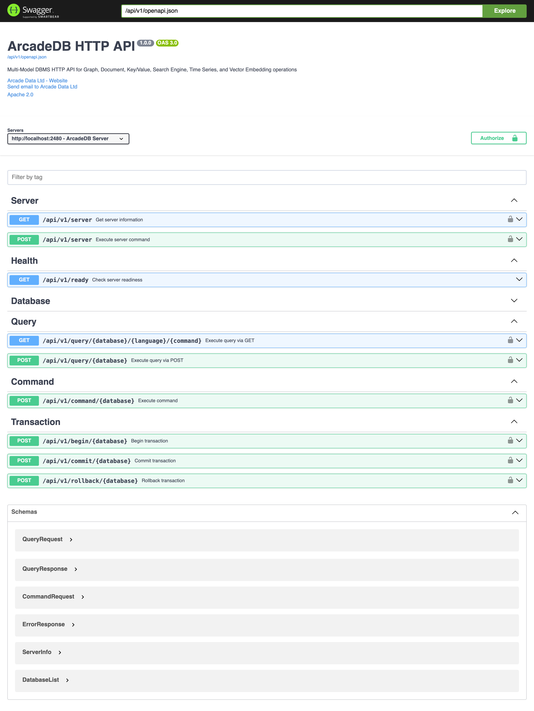

[[swagger-ui]]
=== Swagger-UI

To use the https://swagger.io/tools/swagger-ui/[Swagger-UI], point your web browser to the server and port that hosts the ArcadeDB server at the `/api/v1/docs` endpoint.
For instance, when running ArcadeDB locally with the default port this means: http://localhost:2480/api/v1/docs .

With the Swagger UI you can hands-on explore the <<http-json-api,HTTP API>> and test requests.

NOTE: The page is served with the Content-Security-Policy of <<setting-table,`arcadedb.server.httpContentSecurityPolicy`>>,
which refuses inline script by default. The page adds the hash of its own bootstrap script to the directive that
governs script (`script-src-elem`, else `script-src`, else `default-src`), so a custom policy does not need to allow it.
If your policy refuses every script there (`'none'`), the page cannot start: the server logs a warning once and leaves
the policy as configured. _(Since v26.11.1.)_
